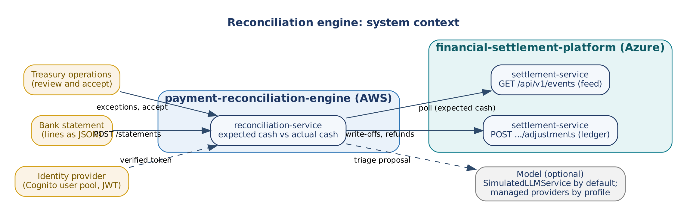
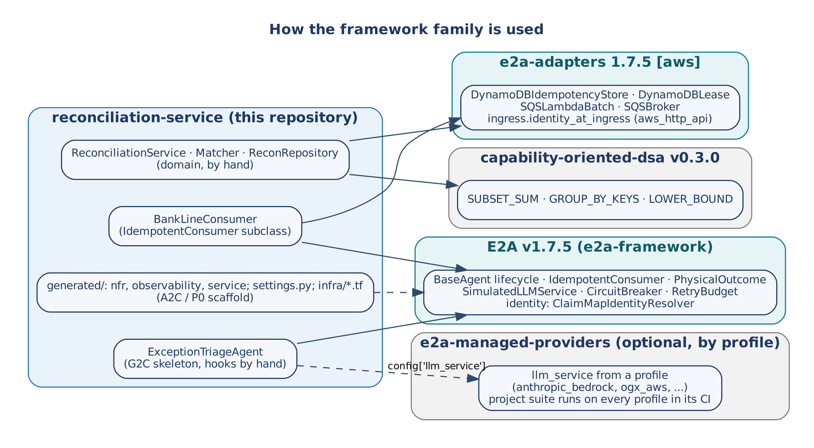
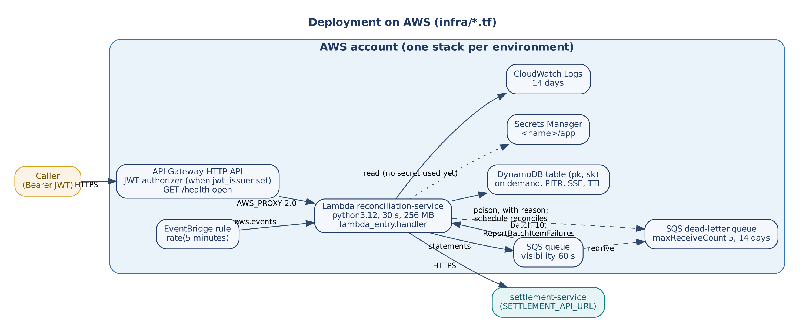
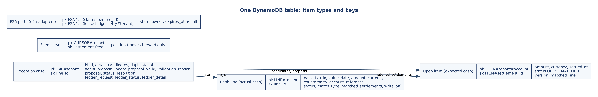
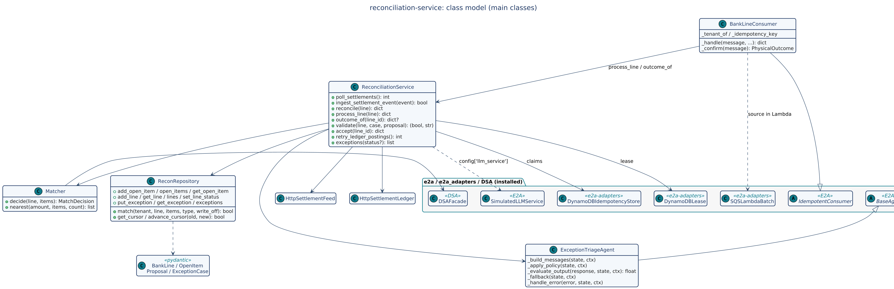
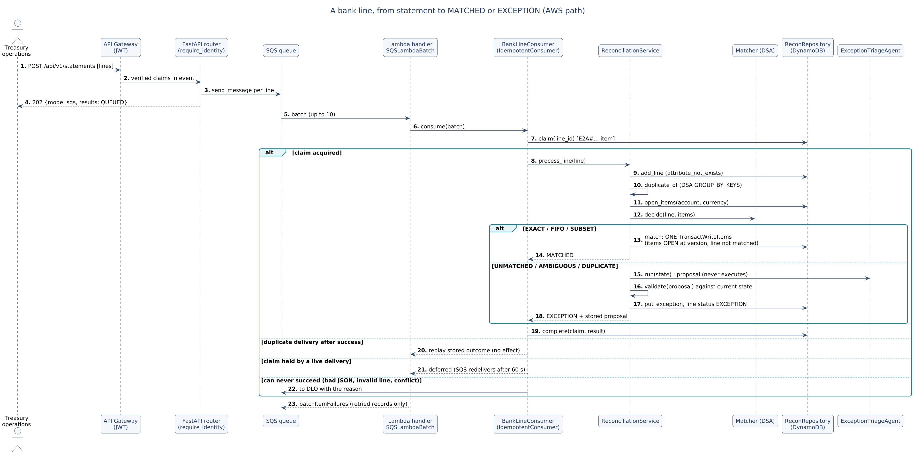
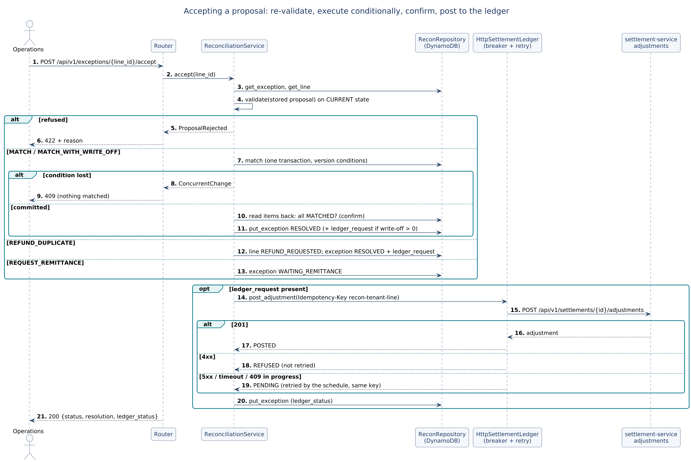
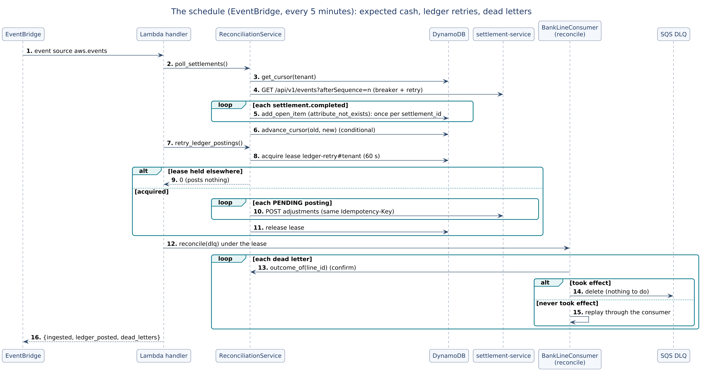
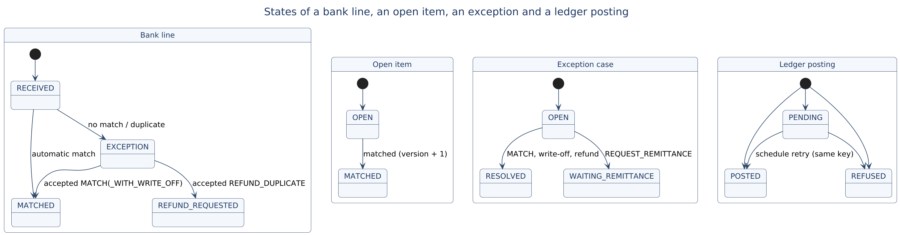

# Reconciliation Engine — Design

### High-Level and Low-Level Design

*This document describes `reconciliation-service`, the AWS service that proves the cash the settlement platform expects really arrived. It matches bank-statement lines (actual cash) against completed settlements (expected cash) with deterministic, bounded algorithms. It hands what it cannot match to an E2A agent that only proposes, and executes an accepted proposal only after re-validating it and writing it conditionally. The document covers the design from the requirements down to class contracts, as the code on `main` implements it. It follows the structure of the E2A, A2C and e2a-managed-providers design documents, and refers to them rather than repeating them.*

| | |
|---|---|
| Project | `payment-reconciliation-engine` — service `reconciliation-service` |
| Document type | Design Document (HLD + LLD) |
| Author | Subham Gupta, Principal Platform Architect |
| Source baseline | `subhamviky/payment-reconciliation-engine` `main` at `5d3a5f4`: `reconciliation-service/src` (18 modules with code, about 1,300 lines), `infra/*.tf`, `contracts/`, 12 test modules. Frameworks: E2A `v1.9.1` (`e2a-framework`), `e2a-adapters` 1.9.1 `[aws]`, `capability-oriented-dsa` `v0.3.0` |
| Date | 21 November 2026 (E2A v1.9.1; first issue 16 November 2026) |
| Status | Describes the code on `main`. Section 14 lists where the code and the original requirements differ. |

## 1. Introduction

### 1.1 Purpose

Settlement completes on one platform; cash arrives at a bank. Nothing proves the two agree unless something reconciles them, line by line, and explains every difference. `reconciliation-service` does that for one tenant per deployment.

This document is the design reference for it:
- what it is for and which requirements drive it (Sections 2 and 3);
- the principles it keeps (Section 4);
- the high-level design: context, how the framework family is used, components, deployment, integration, identity, model access (Section 5);
- the data design (Section 6);
- the low-level design: modules, class model and the contract of each class (Sections 7 and 8);
- dynamic behaviour as sequence and state models (Section 9);
- consistency, concurrency and failures (Section 10);
- non-functional design (Section 11), configuration (Section 12), verification (Section 13), and gaps and deviations (Section 14).

### 1.2 Audience

| Reader | Read |
|---|---|
| Architects | Sections 2, 4, 5, 10 and 14 |
| Engineers changing the service | Sections 6 to 10 and 12 |
| Operations | Sections 5.4, 9.3, 10, 11 and 12 |
| Reviewers of the frameworks | Section 5.2 and the class contracts in Section 8 |

### 1.3 Status labels

| Label | Meaning |
|---|---|
| **Implemented** | In the code on `main`, with tests that CI runs |
| **Configured** | Implemented, and active only when its setting is given (for example identity at ingress) |
| **Gap** | Not done, or done differently from what a requirement or the scaffold intended (Section 14) |

### 1.4 Source of truth and related documents

The code is the source of truth; this document explains it. Related documents:

| Document | Where | Used for |
|---|---|---|
| Requirements and the first implementation guide | the private hub (`reconciliation/REQUIREMENTS.md`, `IMPLEMENTATION_GUIDE.md`) | The use cases, business rules and acceptance criteria this design traces to |
| E2A Framework — Agentic Core | `e2a-framework/docs/design/core/` | `BaseAgent` lifecycle, the propose → authorize → execute → confirm pattern, stores and leases |
| E2A Family System | `e2a-framework/docs/design/system/` | How E2A, A2C, G2C, P0 and AI-DLC fit together |
| A2C, G2C and P0 Framework designs | `a2c-framework/docs/design/` | What generated the scaffold, the agent skeleton and the infrastructure |
| e2a-managed-providers core design | `e2a-managed-providers/docs/design/core/` | Replacing the simulated model with a managed provider through a profile |
| `contracts/` in this repository | `contracts/statements/`, `contracts/vendor/` | The bank line this service owns, and the settlement event it consumes |

Product names (AWS, Amazon DynamoDB, AWS Lambda and others) are trademarks of their owners and are used only to describe the design.

## 2. Problem and Requirements

### 2.1 The problem

Three things make reconciliation hard to get right:
- **Many-to-one and near misses.** A customer pays several settlements in one transfer, or pays a little short because of a bank fee. Exact one-to-one matching misses both.
- **Duplicates.** The same payment can arrive twice, under the same bank transaction id or with identical details.
- **At-least-once delivery.** Statements, queue messages and settlement events can all arrive more than once, and a Lambda can stop half-way. An item must never be matched twice, and a line must never be half-matched.

A model can help explain an exception, but it can be wrong: it may propose a write-off larger than policy allows, or name a settlement that is not a candidate. Its output must never change state on its own.

### 2.2 Requirements traced to the design

| Requirement (hub `REQUIREMENTS.md`) | Design | Section |
|---|---|---|
| UC-1 Learn the expected cash; BR-1, BR-2 | `poll_settlements`, conditional open-item put, forward-only cursor | 8.1, 9.3 |
| UC-2 Submit a bank statement; BR-3 | `POST /statements` → SQS → `BankLineConsumer` under one claim per `line_id` | 8.4, 9.1 |
| BR-4 Duplicate payment | `duplicate_of` with DSA `GROUP_BY_KEYS` | 8.2 |
| BR-5, BR-6, BR-7 Candidates, order, bounded search | `Matcher.decide`: EXACT → FIFO → SUBSET (DSA `SUBSET_SUM`) | 8.2 |
| BR-8 Atomic match | `ReconRepository.match`: one `TransactWriteItems` | 8.3 |
| BR-9 Exceptions with nearest candidates | `_exception`, `Matcher.nearest` (DSA `LOWER_BOUND`) | 8.1, 8.2 |
| BR-10 The agent proposes only | `ExceptionTriageAgent` | 8.5 |
| BR-11 The rules authorize | `ReconciliationService.validate` | 8.1 |
| BR-12 Execution with confirmation; UC-4 | `accept`: re-validate → conditional execute → confirm | 8.1, 9.2 |
| BR-13 Auditability; UC-3 | The exception case keeps the agent's proposal, the verdict and the executed proposal | 6 |
| UC-5 Look up a line | `GET /lines/{line_id}` | 8.7 |
| NFRs (Section 6 of the requirements) | Section 11 of this document | 11 |

### 2.3 What changed since the requirements were written

The requirements describe the first build (E2A v1.1). The code has moved on. This design describes the code; Section 14 lists each difference.
- Accepted write-offs and refunds are now **posted to the settlement ledger**. This was a backlog item.
- Bank lines are settled by **E2A's `IdempotentConsumer`** (E2A v1.7.2), with a claim per line in DynamoDB, a dead-letter queue the schedule reconciles, and a resumable handler.
- **Identity at ingress** (E2A v1.7.4) is configured with API Gateway's JWT authorizer. Authentication was a backlog item.
- The model can be a **managed provider** chosen by profile (e2a-managed-providers). CI runs this project's suite on every profile.
- Subset search uses DSA `SUBSET_SUM` (DSA v0.3) instead of `KNAPSACK_01` + `SUBSETS`.

## 3. Use Cases and Non-goals

### 3.1 Actors

| Actor | Interaction |
|---|---|
| Treasury operations | Submit statements, review exceptions, accept proposals |
| EventBridge schedule | Every 5 minutes: poll the settlement feed, retry ledger postings, reconcile dead letters |
| settlement-service (financial-settlement-platform) | Serves the event feed (expected cash) and accepts ledger adjustments |
| Identity provider (Cognito) | Issues the tokens API Gateway verifies |
| Model | Proposes a resolution for an exception (simulated by default) |

### 3.2 Use-case catalogue

| ID | Use case | Outcome |
|---|---|---|
| UC-1 | Learn the expected cash | Each `settlement.completed` event becomes exactly one open item on the payee account |
| UC-2 | Submit a bank statement | Each line is reconciled once: MATCHED, or an exception with a validated proposal |
| UC-3 | Review exceptions | Open exceptions with kind, detail, candidates, the agent's proposal, whether the rules accepted it and why |
| UC-4 | Accept a proposal | Re-checked against the current state and executed, or refused with a reason; write-offs and refunds posted to the ledger |
| UC-5 | Look up a line | Status, match type, matched settlements and write-off |
| UC-6 | Retry ledger postings | Pending postings re-sent with their original idempotency key |
| UC-7 | Reconcile dead letters | Each dead-lettered line is confirmed against the store, and replayed only if it never took effect |

### 3.3 Non-goals

- Parsing bank file formats (camt.053, MT940).
- One-to-many matching (one open item paid by several lines), partial payments carried forward, FX.
- More than one tenant per deployment.
- A user interface.

## 4. Design Principles and Invariants

### 4.1 Principles

| Principle | Where it shows |
|---|---|
| **Probabilistic intelligence proposes; deterministic controls authorize, execute and confirm** (E2A) | The agent only writes `state['proposal']`. `validate` decides, `match` executes conditionally, `accept` reads back to confirm. |
| **Effects are effectively-once under at-least-once delivery** (E2A) | Conditional puts, a transactional match, a claim per line, idempotency keys on ledger postings |
| **Bounded computation** (DSA) | Subset search over at most 9 candidates and 10,000 nodes; a stopped search is AMBIGUOUS, never "no match" |
| **Money is `Decimal`** | `BankLine.amount`, `OpenItem.amount`; DSA scale 2; strings on the wire |
| **Fail closed** | Identity at ingress, rule validation, the agent's fallback to `REQUEST_REMITTANCE` |

### 4.2 Invariants

| ID | Invariant | Enforced by |
|---|---|---|
| I-1 | An open item is matched at most once | Item update conditioned on `status = OPEN AND version = v` in the match transaction |
| I-2 | A line is never half-matched | All item updates and the line update in ONE `TransactWriteItems` |
| I-3 | One open item per `settlement_id`; one line per `line_id` | `attribute_not_exists(pk)` puts |
| I-4 | The feed cursor only moves forward | Conditional put on the old position |
| I-5 | No model output changes state unvalidated | `validate` before storing the proposal, again before executing it |
| I-6 | A ledger adjustment is posted at most once | `Idempotency-Key: recon-<tenant>-<line_id>`, replayed by settlement-service |
| I-7 | Two ledger retries never run at once | A DynamoDB lease `ledger-retry#<tenant>` |
| I-8 | A line is processed once however it arrives (SQS, HTTP, replay) | An E2A claim on `line_id`, and a resumable handler |

## 5. High-Level Design

### 5.1 System context



The service sits between the settlement platform (expected cash, on Azure) and the bank (actual cash). It reads settlement events, receives bank lines, and writes back only ledger adjustments that operations accepted.

### 5.2 How the framework family is used



| Framework | Used for | Where |
|---|---|---|
| **AI-DLC / P0** | The Poetry project, FastAPI `main.py`, Dockerfile, Makefile, dev container, first test | `aidlc/requests/reconciliation-service.json`, the `aidlc-scaffold` workflow |
| **G2C** | The `ExceptionTriageAgent` skeleton on the installed E2A `BaseAgent`; hooks written by hand on E2A v1.2 hooks | `agents/` |
| **A2C** | The specification, AWS Terraform (Lambda, HTTP API, SQS + DLQ, secret, logs) and its test, the NFR modules (`call_with_resilience`, observability), declared settings | `docs/a2c/spec.md`, `infra/`, `generated/`, `settings.py` |
| **E2A runtime** | `BaseAgent.run` (policy → messages → inference through `config['llm_service']` → evaluation → fallback); `IdempotentConsumer` and `PhysicalOutcome`; `SimulatedLLMService`; `CircuitBreaker`, `RetryBudget`; the conformance check in CI | `agents/`, `services/line_consumer.py`, `services/llm.py`, the clients |
| **e2a-adapters `[aws]`** | `DynamoDBIdempotencyStore` (claim per line), `DynamoDBLease` (ledger retry), `SQSLambdaBatch` and `SQSBroker` (consumer source and DLQ), `identity_at_ingress` (`aws_http_api`) | `recon_service.py`, `lambda_entry.py`, `routers/identity.py` |
| **e2a-managed-providers** | Optional. A profile can replace `build_triage_llm()` with a managed provider's `llm_service` (for example `anthropic_bedrock` or `ogx_aws` on AWS). The provider repository's CI runs this suite on every profile through `E2A_SWAP_FACTORIES`. | `services/llm.py:build_triage_llm` is the swap point |
| **DSA** | `SUBSET_SUM` (many-to-one), `GROUP_BY_KEYS` (duplicates), `LOWER_BOUND` (nearest candidates) | `services/matching.py` |

**Dispositions, in the managed-providers vocabulary.**
- **E2A kept:** the agent lifecycle, the consumer, the claim and lease semantics, and the authorize/execute/confirm pattern.
- **Composed:** E2A's stores and consumer source come from AWS services (DynamoDB, SQS) through e2a-adapters.
- **Replaceable:** the model, which is simulated here and can be a managed provider by profile.

### 5.3 Logical architecture

| Component | Responsibility |
|---|---|
| `lambda_entry.handler` | One Lambda, three event shapes: SQS batch, EventBridge schedule, HTTP (Mangum) |
| FastAPI routers | The HTTP API; every route depends on `require_identity` |
| `ReconciliationService` | The use cases: ingest, reconcile, validate, accept, post, retry |
| `Matcher` | Deterministic matching and nearest candidates (DSA) |
| `ReconRepository` | DynamoDB single-table access; every change is a conditional write |
| `BankLineConsumer` | E2A `IdempotentConsumer` for bank lines: claim, handle, confirm |
| `ExceptionTriageAgent` | E2A `BaseAgent`: proposes one action for an exception |
| `HttpSettlementFeed`, `HttpSettlementLedger` | settlement-service clients behind a circuit breaker and bounded retry |

### 5.4 Deployment on AWS



| Resource (Terraform) | Configuration |
|---|---|
| `aws_lambda_function.app` | Python 3.12, 30 s timeout, 256 MB; handler `reconciliation_service.lambda_entry.handler`; environment from Terraform (no secrets) |
| `aws_apigatewayv2_api.http` + integration + `$default`/proxy route | HTTP API, `AWS_PROXY`, payload format 2.0 |
| `aws_apigatewayv2_authorizer.jwt` (`identity.tf`) | **Configured** when `jwt_issuer` is set: every route but `GET /health` requires a verified JWT |
| `aws_sqs_queue.main` / `.dlq` | Visibility timeout 60 s; redrive after `max_receive_count` (5); DLQ retention 14 days |
| `aws_lambda_event_source_mapping.queue` | Batch size 10, `ReportBatchItemFailures` |
| `aws_cloudwatch_event_rule.poll` (`schedule.tf`) | `rate(5 minutes)` → the same Lambda |
| `aws_dynamodb_table.recon` (`dynamodb.tf`) | `pk`/`sk`, on demand, point-in-time recovery, encryption at rest, TTL on `ttl` |
| `aws_secretsmanager_secret.app` | Created; the value is set out of band; no secret is read by the code today (Section 14) |
| `aws_cloudwatch_log_group.app` | 14 days |
| IAM role policy | Queue and DLQ actions, logs, the secret; DynamoDB Get/Put/Update/Query on this table only |

The timings fit together:
- **Lambda timeout 30 s:** no live invocation runs longer.
- **Claim lease 45 s:** outlives any live invocation.
- **SQS visibility timeout 60 s:** by the time SQS redelivers, the claim of a stopped invocation has expired, so the next delivery takes it over.

### 5.5 Integration and contracts

| Interface | Direction | Contract |
|---|---|---|
| `GET {SETTLEMENT_API_URL}/api/v1/events?afterSequence=n&limit=100` | consumed | `contracts/vendor/settlement-event.v1.schema.json` (vendored; CI `contract-drift` compares it to the producer's `main`) |
| `POST {SETTLEMENT_API_URL}/api/v1/settlements/{id}/adjustments` | called | `{type, amount, reason, reference}` with headers `X-Tenant-Id` and `Idempotency-Key`; 201 posted, 4xx refused, 5xx or "409 in progress" not definitive |
| `POST /api/v1/statements` | offered | `contracts/statements/bank-statement-line.v1.schema.json` (owned) |

### 5.6 Identity and security

- **Callers.** With `jwt_issuer` set, API Gateway verifies the JWT. The Lambda then reads the verified claims from the event (`identity_at_ingress`, source `aws_http_api`, Cognito claim preset), requires that they name this deployment's tenant (`RECON_TENANT`), and optionally a role (`RECON_REQUIRED_ROLE`). The result: no verified claims is 401, another tenant or a missing role is 403. `GET /health` stays open. Without `jwt_issuer`, identity is off; that is for local and moto runs only.
- **The service's own access.** The Lambda role's least-privilege policy covers this queue and its DLQ, its log group, its secret and its table.
- **Service callers** (hub design note SI-01). o2c-agent-service reads open exceptions on `GET /service/v1/exceptions`, a route with its own JWT authorizer (`service_jwt_issuer`: the landscape's Entra directory; audience: the reconciliation app). The users' Cognito authorizer keeps every other route.
  - **What the Lambda checks** (`service_identity`): the claims, with the `entra_service` preset and only that issuer trusted (`RECON_SERVICE_TRUSTED_ISSUERS`).
  - **What it requires:** `X-Tenant-Id` must be this deployment's tenant and granted to the caller (app role `tenant:<id>`), and the caller must hold `reconciliation.read`.
  - **Separation:** a service token on a user route names no tenant there and is refused. Without a service issuer, a deployment that verifies users has no service route at all.
- **Calls to settlement-service** carry this service's own token. The Lambda role gets a web identity token from STS (IAM outbound identity federation, `sts:GetWebIdentityToken`) and exchanges it for an Entra token for the settlement app (`e2a_adapters.workload`). The Entra apps, roles and grants are in financial-settlement-platform's `landscape-identity/`: reconciliation may adjust and read.

### 5.7 Model access

`build_triage_llm()` returns E2A's `SimulatedLLMService` with one rule that behaves like a helpful but unreliable model. It proposes a write-off whenever the nearest candidate is within 2 % of the amount, even beyond the write-off limit only the rules know. That is the case the validation must catch, and a test proves it does.

A managed provider replaces it by profile: the factory is the swap point, and the agent reaches the model only through `config['llm_service']`. No code changes. The managed providers' design documents describe what each provider adds or changes.

## 6. Data Design



One table, keyed by `pk`/`sk`; every key is tenant-scoped.

| Item | `pk` | `sk` | Attributes |
|---|---|---|---|
| Open item | `OPEN#<tenant>#<account>` | `ITEM#<settlement_id>` | amount, currency, settled_at, status (`OPEN`/`MATCHED`), version, matched_line |
| Bank line | `LINE#<tenant>` | `<line_id>` | the line; status; match_type; matched_settlements; write_off |
| Exception case | `EXC#<tenant>` | `<line_id>` | kind, detail, candidates, duplicate_of, agent_proposal, agent_proposal_valid, validation_reason, proposal, status, resolution, ledger_request, ledger_status, ledger_detail, ledger_adjustment_id |
| Feed cursor | `CURSOR#<tenant>` | `settlement-feed` | position |
| E2A claim | `E2A#...` (e2a-adapters) | kind | state, owner, expires_at, result — one per `line_id` |
| E2A lease | `E2A#...` (e2a-adapters) | kind | owner, expires_at — `ledger-retry#<tenant>` |

Open items of one account and currency are read with one query on `OPEN#<tenant>#<account>` and filtered by status and currency. Money is stored as strings from `model_dump_json()`, so no float ever touches it.

## 7. Low-Level Design — Module Structure and Class Model

### 7.1 Module structure

| Module | Contents |
|---|---|
| `main.py` | `build_service()` (wiring from the environment), `build_app()` (FastAPI, line queue, `/health`) |
| `lambda_entry.py` | `handler(event, context)` |
| `routers/recon.py`, `routers/identity.py` | The HTTP API; `require_identity` |
| `services/recon_service.py` | `ReconciliationService`; exceptions `ProposalRejected`, `ConcurrentChange`, `LineInProgress`, `LineConflict`; `CONSUMER_CONFIG` |
| `services/matching.py` | `Matcher`, `MatchDecision`, `payment_keys`, `duplicate_of` |
| `services/repository.py` | `ReconRepository` |
| `services/line_consumer.py` | `BankLineConsumer` |
| `services/queue.py` | `SqsLineQueue`, `DirectLineQueue` |
| `services/settlement_client.py`, `services/ledger_client.py` | `HttpSettlementFeed`, `HttpSettlementLedger`, `adjustment_request`, `ledger_key` |
| `services/llm.py` | `build_triage_llm()` (the swap point), `AGENT_MARKER` |
| `agents/exception_triage_agent.py` | `ExceptionTriageAgent`, `ALLOWED`, `SAFE_DEFAULT` |
| `models/records.py` | `BankLine`, `OpenItem`, `Proposal`, `ExceptionCase` |
| `generated/` (A2C) | `nfr.call_with_resilience`, `observability` (JSON logging, metrics, tracing, SLO checker), `service` |
| `settings.py` (A2C) | Declared settings and `load_settings()` |

### 7.2 Class model



## 8. Low-Level Design — Class Contracts

### 8.1 `ReconciliationService`

| Method | Contract |
|---|---|
| `poll_settlements() -> int` | Reads the cursor, fetches events after it, ingests each `settlement.completed`, advances the cursor conditionally from the position it read. Returns the number of new open items. |
| `ingest_settlement_event(event) -> bool` | `settlement.completed` only: an open item for the payee account (`attribute_not_exists`). False for another type or a repeat. |
| `reconcile(line) -> dict` | HTTP and local path: publishes the line on an in-process broker and settles it with the same `BankLineConsumer` and claim as an SQS delivery. Returns the outcome; a repeat after success returns `ALREADY_RECEIVED` with the stored outcome; raises `LineInProgress` (claim held) or `LineConflict` (same id, different content). |
| `process_line(line) -> dict` | The effect of one line, under the consumer's claim. **Resumable:** if the line was already stored, it returns the stored outcome when there is one. Otherwise it checks for duplicates, decides with `Matcher`, and matches in one transaction or creates an exception. |
| `outcome_of(line_id) -> dict?` | The stored outcome: MATCHED with its settlements, or EXCEPTION with the stored proposal; None if the line stopped before a decision. Used to resume and to confirm dead letters. |
| `validate(line, case, proposal) -> (bool, reason)` | The deterministic authority, on **current** state. **Remittance request:** always allowed. **Refund:** a DUPLICATE only, and only after the original line is MATCHED. **MATCH:** every named item is OPEN, of this account and currency, and the total equals the line. **MATCH_WITH_WRITE_OFF:** exactly one item, and the difference is at most `write_off_limit` (5.00). |
| `accept(line_id) -> dict` | **Refused** (`ProposalRejected`, 422) when there is no open exception, or when re-validation fails. **Executed** as below. The decision is stored before the ledger call. |
| `retry_ledger_postings() -> int` | Under the lease `ledger-retry#<tenant>` (60 s): re-sends every PENDING posting unchanged. Returns 0 without posting if another run holds the lease. |

How `accept` executes each action:

| Action | Execution |
|---|---|
| `MATCH`, `MATCH_WITH_WRITE_OFF` | The conditional match. A lost condition, or items not read back as MATCHED, raises `ConcurrentChange` (409). A write-off greater than zero creates a ledger request. |
| `REFUND_DUPLICATE` | Line set to `REFUND_REQUESTED`; a ledger request against the original's settlement |
| `REQUEST_REMITTANCE` | Exception set to `WAITING_REMITTANCE` |

### 8.2 `Matcher` and duplicates

| Function | Contract |
|---|---|
| `decide(line, open_items)` | Candidates: OPEN items of the line's currency (already filtered to its account), tried in order: (1) **EXACT**, the reference equals a settlement id with the same amount; (2) **FIFO**, the oldest item with the same amount; (3) **SUBSET**, DSA `SUBSET_SUM` over the 9 oldest smaller items, target the amount, scale 2, `max_nodes` 10,000. A search stopped by its bound, or a "not found" when candidates were capped, is **AMBIGUOUS**; otherwise "not found" is **UNMATCHED**. |
| `nearest(amount, items, count=3)` | DSA `LOWER_BOUND` on items sorted by amount; a window around the index, ordered by distance then age |
| `duplicate_of(new_line, existing)` | DSA `UNION_FIND` `GROUP_BY_KEYS` on two keys: the bank transaction id, or (amount, currency, value date, counterparty account, reference). Returns the earliest other line in the group (value date, then id). |

### 8.3 `ReconRepository`

Every state change is conditional, and only a lost condition is reported as `False`. `_conditional_failure` accepts `ConditionalCheckFailedException`, or a `TransactionCanceledException` whose reasons are all `ConditionalCheckFailed` or `None`. Any other error is raised, never hidden.

| Method | Condition |
|---|---|
| `add_open_item`, `add_line` | `attribute_not_exists(pk)` |
| `match(tenant, line, items, type, write_off)` | One `TransactWriteItems`: each item `status = OPEN AND version = v` → MATCHED, version + 1, matched_line; the line `status IN (RECEIVED, EXCEPTION)` → MATCHED with settlements, type and write-off. |
| `advance_cursor(old, new)` | No cursor yet, or `position = old` |
| `put_exception`, `set_line_status` | Unconditional (written under the line's claim, or after a successful re-validation) |

### 8.4 `BankLineConsumer` (E2A `IdempotentConsumer`)

| Hook | Contract |
|---|---|
| `_tenant_of` | The deployment's tenant |
| `_idempotency_key` | The body's `line_id`; None for a body that is not JSON, which the consumer dead-letters with the reason |
| `_handle` | Validates `BankLine` (a validation error is a `ValueError`: dead-lettered), then `process_line`; marks `physical_success` |
| `_confirm` | For a dead letter: `COMMITTED` if the store holds an outcome for the line, else `NOT_COMMITTED` (replayed) |

`CONSUMER_CONFIG` sets the following:
- **`idempotency_lease_seconds` (45):** the claim lease.
- **`consumer_resume_expired`:** an expired claim is taken over, because the handler is resumable.
- **`consumer_max_deliveries` (0):** SQS's redrive policy limits deliveries, not the consumer.
- **`consumer_retry_delay_seconds` (0):** no extra delay before a redelivery.

### 8.5 `ExceptionTriageAgent` (E2A `BaseAgent`, G2C skeleton)

| Hook | Contract |
|---|---|
| `_apply_policy(state, ctx)` | A tenant is required (`PermissionError`); the kind must be UNMATCHED, AMBIGUOUS or DUPLICATE |
| `_build_messages(state, ctx)` | A system message naming the allowed actions and the JSON shape; a user message with kind, detail, amount, currency, counterparty and candidates |
| `_evaluate_output(response, state, ctx)` | Score 1.0 only for JSON that parses as a `Proposal` whose settlement ids are all candidates; it then sets `state['proposal']`. Otherwise 0.0. |
| `_fallback`, `_handle_error` | `SAFE_DEFAULT` = `REQUEST_REMITTANCE` |

The service runs it with `min_confidence` 0.5 and `max_latency` 5 s, and idempotency key `line_id`.

### 8.6 settlement-service clients

| Class | Contract |
|---|---|
| `HttpSettlementFeed.events_after(tenant, after)` | GET the feed through `call_with_resilience`: circuit breaker (5 failures, 30 s), shared retry budget, 3 retries with jitter; raises on failure. The schedule tries again in 5 minutes. |
| `HttpSettlementLedger.post_adjustment(tenant, request)` | POST with `Idempotency-Key` and 2 retries. **POSTED:** 201, with the adjustment id. **REFUSED:** any 4xx except "409 in progress". **PENDING:** 5xx, a timeout, a transport error or "409 in progress", after the retries. |

### 8.7 HTTP API (`routers/recon.py`)

| Route | Responses |
|---|---|
| `POST /api/v1/statements` (array of `BankLine`) | 202 `{mode, results}`. `mode` is `sqs` (each result `QUEUED`) or `direct` without `QUEUE_URL`. In `direct` mode each result is the outcome, `IN_PROGRESS` or `CONFLICT`. |
| `POST /api/v1/settlements/poll` | `{ingested}` |
| `POST /api/v1/ledger/retry` | `{posted}` |
| `GET /api/v1/lines/{line_id}` | 200 the line · 404 |
| `GET /api/v1/exceptions?status=` | Exception cases |
| `POST /api/v1/exceptions/{line_id}/accept` | 200 · 422 refused · 409 concurrent change |
| `GET /health` | `{status: UP}`; no identity required |

All `/api/v1` routes depend on `require_identity`: 401 or 403 when identity is configured and refused.

### 8.8 `lambda_entry.handler`

| Event | Handling |
|---|---|
| SQS (`eventSource` `aws:sqs`) | `BankLineConsumer(service, SQSLambdaBatch(event)).consume(...)`. Retried and dead-lettered lines are logged; returns `batchItemFailures` (retried records only) |
| EventBridge (`source` `aws.events`) | `poll_settlements()`, `retry_ledger_postings()`, then `reconcile` the DLQ under the service's lease; returns the three results |
| Anything else | The FastAPI app through Mangum |

## 9. Dynamic Behaviour

### 9.1 A bank line



### 9.2 Accepting a proposal



### 9.3 The schedule



### 9.4 States



## 10. Consistency, Concurrency and Failures

| Situation | What happens | Mechanism |
|---|---|---|
| The same settlement event delivered twice | One open item | Conditional put |
| Two pollers at once | Both may fetch; each item is created once; the cursor moves once from each read position | Conditional puts and cursor |
| The same line delivered twice, after success | The stored outcome is replayed; no effect | E2A claim (`duplicate`) |
| Two deliveries of one line at once | The second is deferred; SQS redelivers it after 60 s | Claim held (`deferred`) |
| The Lambda stops after storing the line, before deciding | The next delivery takes over the expired claim and finishes from the stored state | `consumer_resume_expired`; `process_line` is resumable |
| The Lambda stops after matching | The next delivery finds the outcome and reports it; nothing is matched twice | `outcome_of`; the line's condition |
| Two lines race for the same open item | One transaction commits; the other fails its condition and becomes an exception | Version conditions |
| Accept races with another writer | 409; nothing changes | Transaction condition; read-back confirmation |
| A line that can never succeed (bad JSON, invalid line, same id with different content) | Dead-lettered at once with the reason | Consumer `dead_lettered` |
| A line still failing after 5 deliveries | Moved to the DLQ by SQS | Redrive policy |
| A dead letter | Confirmed against the store: removed if it took effect, replayed if not | Consumer `reconcile` + `_confirm` |
| settlement-service down during polling | The poll fails; the cursor does not move; next schedule tries again | Breaker, retry, conditional cursor |
| Ledger down during accept | The decision is stored; the posting is PENDING and retried by the schedule with the same key | Typed outcome, idempotency key |
| Two ledger retries at once | One posts; the other returns 0 | DynamoDB lease |
| The model answers nonsense, or is unavailable | The proposal falls back to a remittance request | `_evaluate_output`, `_fallback`, `_handle_error` |
| The model proposes a write-off beyond the limit | Refused by `validate`, recorded with the reason, replaced by a remittance request | `validate`, BR-11 |

## 11. Non-Functional Design

| NFR | Design |
|---|---|
| Idempotency and consistency | Sections 4.2 and 10 |
| Reliable intake | Partial batch failures; poison lines dead-lettered at once with a reason; a DLQ kept 14 days and reconciled every 5 minutes |
| Resilience | Circuit breaker and bounded jittered retry on both settlement-service calls; typed ledger outcomes |
| Bounded computation | At most 9 candidates and 10,000 search nodes per line; duplicates grouped in one pass over the tenant's lines |
| AI governance | Propose → validate → store → re-validate → execute → confirm; fallback below `min_confidence` 0.5 |
| Tenancy | One tenant per deployment; every key tenant-scoped; identity requires the deployment's tenant; the agent refuses a call without one |
| Security | JWT at the edge (when configured); least-privilege role; encryption at rest; no secrets in code or Terraform |
| Observability | `/health`; standard logging of retried and dead-lettered lines; CloudWatch logs. The A2C observability module is not wired in (Section 14). |
| Cost | On-demand DynamoDB, Lambda per invocation, a 5-minute schedule. Model token usage is accounted by E2A's LLM service. |
| Scale limits | `duplicate_of` reads all of the tenant's lines per new line. That is acceptable for statement volumes per tenant today, and it is the first thing to index for large volumes (Section 14). |

## 12. Configuration

| Setting | Source | Default | Used by |
|---|---|---|---|
| `TABLE_NAME` | Terraform | `reconciliation` (code) | `ReconRepository` |
| `QUEUE_URL` | Terraform | unset: direct mode | Line queue; DLQ name `<queue>-dlq` |
| `SETTLEMENT_API_URL` | Terraform variable | `http://settlement-service.internal:8080` (Terraform), `http://localhost:8080` (code) | Feed and ledger clients |
| `RECON_TENANT` | Terraform variable | `acme` | The deployment's tenant |
| `E2A_IDENTITY_SOURCE`, `E2A_IDENTITY_TRUSTED_ISSUERS`, `RECON_REQUIRED_ROLE` | `identity.tf` when `jwt_issuer` is set | off | `require_identity` |
| `RECON_SERVICE_TRUSTED_ISSUERS` (and `E2A_IDENTITY_SOURCE`) | `workload.tf` when `service_jwt_issuer` is set | off | `service_identity` (SI-01) |
| `E2A_WORKLOAD_IDENTITY=aws`, `E2A_WORKLOAD_AWS_REGION`, `E2A_WORKLOAD_ENTRA_TENANT`, `E2A_WORKLOAD_ENTRA_CLIENT_ID`, `E2A_WORKLOAD_TOKEN_SCOPES` | `workload.tf` when `entra_directory_id`, `entra_client_id` and `settlement_scope` are set | no token | Calls to settlement-service (SI-01) |
| `E2A_IDENTITY_CLAIM_MAP` | environment | Cognito preset | `require_identity` |
| `LINE_CLAIM_LEASE_SECONDS`, `LEDGER_RETRY_LEASE_SECONDS` | environment | 45, 60 | Claim and lease |
| `poll_schedule`, `max_receive_count`, `jwt_issuer`, `jwt_audience`, `required_role` | Terraform variables | `rate(5 minutes)`, 5, empty | Infrastructure |
| `E2A_SWAP_FACTORIES` | test runs only | — | e2a-managed-providers' plugin swaps `build_triage_llm` for a profile's `llm_service` |

## 13. Verification and Evidence

| Evidence | What it proves |
|---|---|
| `tests/` (55 test functions, 57 cases when run; DynamoDB and SQS mocked by moto) | Matching, duplicates, the full flow, accept races, ledger postings and retries, line claims (stopped invocations, concurrent deliveries), the Lambda handler (batch, poison, schedule, DLQ), identity at ingress, contracts, settings |
| CI `reconciliation-service` | The tests, and E2A's conformance check in strict mode |
| CI `contract-drift` | The vendored settlement contract equals the producer's `main` |
| CI `terraform` | `fmt`, `validate`, `terraform test` with a mock provider |
| CI `terraform-apply-moto` | `terraform apply` to a local moto server, then the real handler reconciles a line through the created queue and table, then `destroy` |
| e2a-managed-providers CI, project-suites | This suite on every managed-provider profile (the model swapped) |

Acceptance criteria AC-1 to AC-18 of the requirements each map to a named test or CI job; the requirements list them.

## 14. Gaps, Deviations and Backlog

| # | Item | Kind | Notes |
|---|---|---|---|
| G-1 | The A2C `generated/observability.py` (JSON logs, metrics, tracing, SLO checker) is not called by the app | Gap | Logging is the standard library's; wire `configure_logging` and `traced` in `main.py` and the handler |
| G-2 | `settings.load_settings()` is declared and tested but `main.py` reads the environment directly, with its own defaults | Gap | `TABLE_NAME` is declared required, yet the code defaults it to `reconciliation` |
| G-3 | Calls to settlement-service carried `X-Tenant-Id` only, without a service credential | Fixed (SI-01) | An Entra token from the role's STS web identity token, no secret (Section 5.6). Not yet run against live clouds. |
| G-4 | A Secrets Manager secret is provisioned and `SECRET_ARN` set, but no secret is read | Note | G-3 needed no secret; remove it, or keep it for a future credential |
| G-6 | O2C's exception query used the user route, which a deployment with `jwt_issuer` refuses without a user token | Fixed (SI-01) | The service routes `/service/v1/exceptions` and `/service/v1/lines/{line_id}` (the latter added for the GenAI assistant, GCP-01) |
| G-5 | `duplicate_of` reads every line of the tenant for each new line | Scale limit | Index payment keys (for example a key item per bank transaction id) for large volumes |
| D-1 | BR-7 names DSA `KNAPSACK_01` + `SUBSETS` with a 1,000 enumeration limit; the code uses `SUBSET_SUM` with `max_nodes` 10,000 | Deviation | DSA v0.3 provides the combined operation with an explicit `complete` flag |
| D-2 | Requirements list ledger posting and authentication as out of scope | Done since | Implemented (Sections 8.1, 5.6) |
| D-3 | One tenant per deployment | Design choice | Multi-tenant would need a tenant per message and per route |
| B-1 | Bank file formats, one-to-many matching, partial payments, FX | Backlog | From the requirements |

## Appendix A — Source files

| Area | Files |
|---|---|
| Entry points | `src/reconciliation_service/main.py`, `lambda_entry.py`, `routers/recon.py`, `routers/identity.py` |
| Domain | `services/recon_service.py`, `services/matching.py`, `services/line_consumer.py`, `services/queue.py`, `models/records.py` |
| Integration | `services/repository.py`, `services/settlement_client.py`, `services/ledger_client.py`, `services/llm.py` |
| Agent | `agents/exception_triage_agent.py` |
| Scaffold | `generated/`, `settings.py`, `.a2c/manifest.json`, `docs/a2c/spec.md` |
| Infrastructure | `infra/main.tf`, `dynamodb.tf`, `schedule.tf`, `identity.tf`, `tests/aws.tftest.hcl`, `moto/` |
| Contracts | `contracts/statements/`, `contracts/vendor/` |
| CI | `.github/workflows/reconciliation-ci.yml`, `aidlc-scaffold.yml` |

The diagrams are rendered from `diagrams/` (Graphviz `.dot` and PlantUML `.puml`, sharing `common/style.puml`):

```
dot -Tpng -Gdpi=220 diagrams/<name>.dot -o images/<name>.png
java -jar plantuml.jar -tpng -o ../images diagrams/<name>.puml
```
